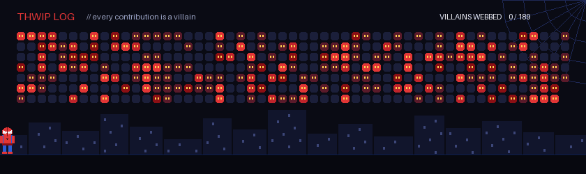

<div align="center">


<a href="https://github.com/navinksyy">
  
</a>

<br/>


</div>

<br/>

## 🛰️ &nbsp;MISSION BRIEFING

```text
> PILOT........ navinskyy
> BASE......... Caloocan City, Philippines
> MISSION...... Breaking things to understand them
> CURRENTLY.... Learning offensive & defensive security
> ASK ME ABOUT. Linux, networks, pentesting & AI
> FUN FACT..... One more commit before I sleep.
```

<br/>

## 🎮 &nbsp;BATTLE LOG

*Every contribution is an enemy. Every commit is a laser shot. Updated daily.*

<div align="center">
  
</div>

<br/>

## 🧰 &nbsp;SHIP SYSTEMS

<div align="center">


</div>

<br/>

## 🌌 &nbsp;ACTIVE MISSIONS

| Mission | Status | Description |
| :-- | :--: | :-- |
| 🚀 **Project Alpha** | 🟢 Active | Short description of your main project |
| 🛰️ **Project Beta** | 🟡 In progress | Something you're building or experimenting with |
| 🔭 **Learning Quest** | 🔵 Exploring | A skill or tech you're picking up |

<br/>

## 📡 &nbsp;OPEN COMMS CHANNEL

<div align="center">

<a href="https://www.linkedin.com/in/YOUR_LINKEDIN">
  
</a>
<a href="mailto:you@example.com">
  
</a>
<a href="https://YOUR_PORTFOLIO.com">
  
</a>

</div>

<br/>

<div align="center">

<sub>⭐ *"In space, no one can hear you git push."* ⭐</sub>


</div>
